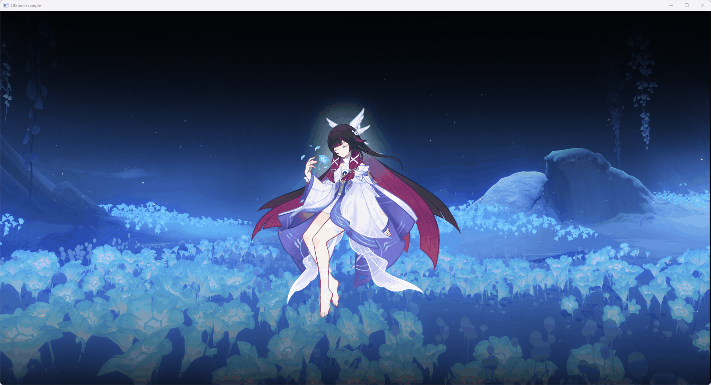
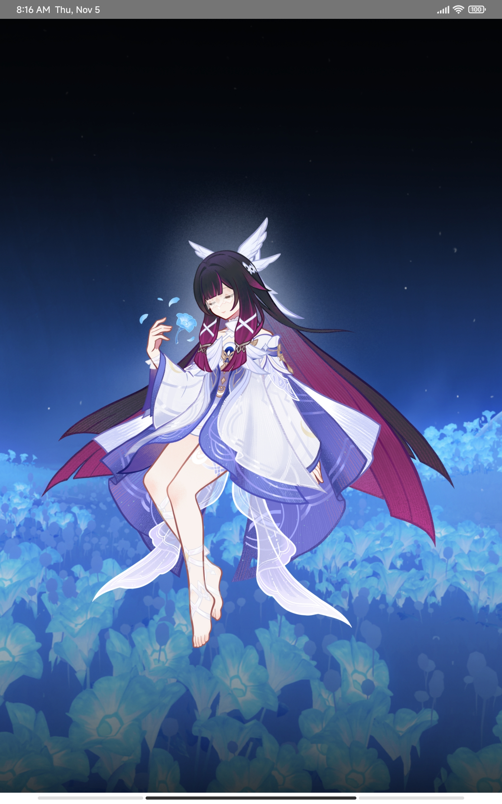

# QtSpine

基于 Qt6 的 QML Spine 运行时，在 Qt Quick 中原生渲染骨骼动画。

## 预览

在线演示（WebAssembly 构建）：<https://CyanArc0.github.io/Columbula/>

**Windows**



**Android**



本地构建仓库根目录的 QtSpineExample 示例工程，可查看完整效果。

## 版本支持

| 组件 | 版本 | 说明 |
|---|---|---|
| Qt | **6.8+** | 设计基线；已验证 6.12.0；最低可尝试 6.7（未验证） |
| Spine Runtimes (spine-cpp) | **4.2** | 当前适配版本 |
| C++ | **C++20 及以上** | 最低已验证 C++17 |
| CMake | **3.18+** | `FetchContent_Declare` 的 `SOURCE_SUBDIR` 自 3.18 引入 |

> **关于 Qt 6.7**：`QQuickRhiItem` 自 Qt 6.7 引入，但当时为技术预览。`QtSpine/` 子目录不强制 Qt 版本，可自行尝试，但 API 与 6.8 可能存在差异，**未经验证，不保证可编译或可运行**。

> **关于 C++17**：`[[unlikely]]` 是 C++20 属性。C++17 标准规定，实现未识别的属性应被忽略（[dcl.attr.grammar]/6），因此不会因其产生编译错误；实现可以给出属性警告。

## 通过 CMake 引入

库本体位于仓库的 `QtSpine/` 子目录，自包含。仓库根目录是示例工程，使用库时**不需要**复制示例代码和资源。

### 方式一：复制 `QtSpine/` 子目录（推荐）

把 `QtSpine/` 复制到项目中。

在默认 `CMakeLists.txt` 中插入两处：

```cmake
add_subdirectory(QtSpine)

# ...

target_link_libraries(appYourProject PRIVATE QtSpine)
```

### 方式二：FetchContent 拉取整个仓库

如果不想手动复制目录，也可以让 CMake 从 GitHub 拉取本仓库。

```cmake
include(FetchContent)
FetchContent_Declare(
    QtSpine
    GIT_REPOSITORY https://github.com/CyanArc0/QtSpine.git
    GIT_TAG 1.0
    SOURCE_SUBDIR QtSpine
)
FetchContent_MakeAvailable(QtSpine)

# ...

target_link_libraries(appYourProject PRIVATE QtSpine)
```

### 关于异常与 RTTI（推荐）

spine-cpp 默认禁用异常和 RTTI。为保证头文件宏与库二进制一致、并让跨平台行为统一，**推荐**在引入 QtSpine 时一并引入仓库提供的 `disable-Exceptions.cmake` 与 `disable-RTTI.cmake`。

```cmake
include(disable-Exceptions.cmake)
include(disable-RTTI.cmake)
```

不引入可能也能正常编译，但部分平台可能会编译失败。

### 插入位置说明

下面以 Qt Creator 默认生成的 Qt Quick 工程为基准。
```cmake
cmake_minimum_required(VERSION 3.18)

project(YourProject VERSION 1.0 LANGUAGES CXX)

find_package(Qt6 REQUIRED COMPONENTS Quick)

qt_standard_project_setup(REQUIRES 6.8)

# ① 推荐：在引入 QtSpine 之前禁用异常与 RTTI
include(disable-Exceptions.cmake)
include(disable-RTTI.cmake)

# ② 引入 QtSpine：方式一，本地子目录
add_subdirectory(QtSpine)

# ② 引入 QtSpine：方式二，FetchContent 拉取（与上一行二选一）
# include(FetchContent)
# FetchContent_Declare(
#     QtSpine
#     GIT_REPOSITORY https://github.com/CyanArc0/QtSpine.git
#     GIT_TAG 1.0
#     SOURCE_SUBDIR QtSpine
# )
# FetchContent_MakeAvailable(QtSpine)

qt_add_executable(appYourProject
    main.cpp
)

qt_add_qml_module(appYourProject
    URI YourProject
    QML_FILES
        Main.qml
    RESOURCES
        p7_bg_gd.png
)

target_link_libraries(appYourProject
    PRIVATE Qt6::Quick
    PRIVATE QtSpine # ③ 无论用哪种引入方式，都需要链接 QtSpine
)
```

引入后，QML 中即可 `import QtSpine`。

## 在 QML 中使用

```qml
import QtQuick
import QtSpine

Window {
    width: 1920
    height: 1080
    visible: true

    SpineItem {
        // 初始居中；不要用 anchors.centerIn，会与 DragHandler 冲突
        x: (parent.width - width) / 2
        y: (parent.height - height) / 2

        // width/height 只决定渲染范围（boundingRect），不改变模型显示大小
        width: implicitWidth * 1.0
        height: implicitHeight * 1.0
        
        scale: 1.0 // scale 才是模型的实际显示缩放，以 item 中心为原点

        skeletonSource: "qrc:/shaonv.json"   // 也支持 .skel
        atlasSource: "qrc:/shaonv.atlas"
        animationName: "a2b2a"

        DragHandler { } // 支持拖动
    }
}
```

### 属性说明

| 属性 | 类型 | 说明 |
|---|---|---|
| `skeletonSource` | `url` | Spine 骨骼文件，支持 `.json` 与 `.skel` |
| `atlasSource` | `url` | Spine atlas 文件；纹理路径相对于该 atlas 所在目录解析 |
| `animationName` | `string` | 要播放的动画名；为空时清空 track 0 |

### 行为说明

- 动画在 `track 0` 上循环播放，切换 `animationName` 会替换当前动画。
- `implicitWidth` / `implicitHeight` 来自 skeleton 数据，可用于布局。
- width/height 只决定渲染范围，scale 才是模型显示缩放；缩放以 item 中心为原点，不影响 x/y 的居中计算。
- 纹理在加载时按 atlas 的 `pma` 标志统一转换为预乘 Alpha，渲染端全程按 PMA 处理。
- Tint Black 的暗色数据来自 skeleton 资源本身，库不额外提供 tint black 控制接口。
- 支持 Normal / Additive / Multiply / Screen 四种混合模式，由 Spine 渲染命令自动选择。
- 渲染基于 Qt RHI（`QQuickRhiItem`），自动适配 Vulkan / Metal / D3D11 / OpenGL 后端。

## 资源加载说明

- `skeletonSource`、`atlasSource` 支持 `qrc:/` 与 `file:` 路径。
- Atlas 中的纹理路径相对于 `.atlas` 文件所在目录解析。
- 资源重新加载时，旧资源按依赖逆序释放，纹理缓存会自动重建。
- 如果遇到纹理加载失败，检查 atlas 中的图片路径是否与资源实际位置一致。

## 许可证与合规

QtSpine 以 **LGPL v3** 发布。完整授权文本由 [`COPYING`](./COPYING)（GNU GPL v3）与 [`COPYING.LESSER`](./COPYING.LESSER)（GNU LGPL v3）共同构成。

使用和分发时需注意三层独立义务：

1. **QtSpine 自身（LGPL v3）**：修改 QtSpine 源代码后，修改部分需以 LGPL v3 开源；未修改使用则专有代码无需开源。
2. **Qt（LGPL v3）**：QtSpine 当前构建为静态库。若你静态链接 Qt，需要向接收方提供可重新链接的材料（如目标文件）；改为动态链接 Qt 可以显著降低合规成本。
3. **spine-cpp（独立许可）**：**使用 QtSpine 需要你自行持有 Spine 许可证。** 如果向不持有 Spine 许可证的人分发包含 spine-cpp 的构建产物，分发者需要在分发时持有相应许可证。

第三方组件与版权声明：

- **Qt 6** — LGPL v3，Copyright (C) The Qt Company Ltd. and other contributors。许可证全文见 <https://www.gnu.org/licenses/lgpl-3.0.html>
- **Spine Runtimes (spine-cpp) 4.2** — Spine Runtimes License Agreement，Copyright (C) Esoteric Software LLC。条款见 <http://esotericsoftware.com/spine-runtimes-license>

**使用 QtSpine 构建的软件，最终用户需要自行持有有效的 Spine 许可证。**

## 致谢

- [Esoteric Software Spine Runtimes](https://github.com/esotericsoftware/spine-runtimes)
- [Qt](https://www.qt.io/)
- [UWillno/spine-qt](https://github.com/UWillno/spine-qt) — 早期实现参考
