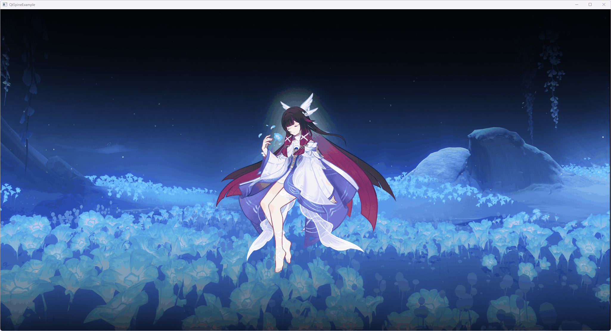
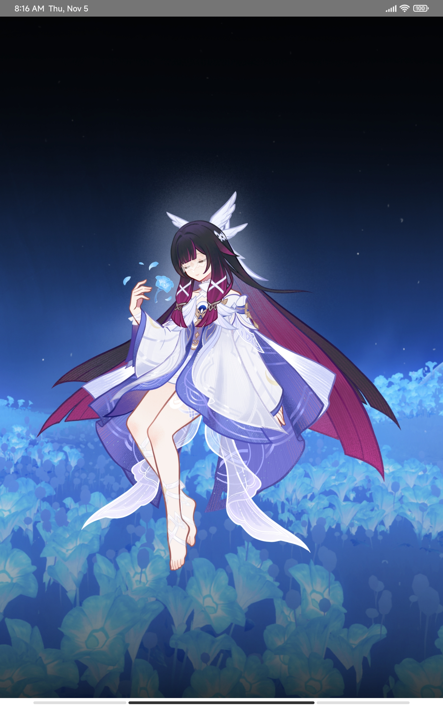

# QtSpine

基于 Qt6 的 QML Spine 运行时，在 Qt Quick 中原生渲染骨骼动画。

## 预览

在线演示（WebAssembly 构建）：<https://CyanArc0.github.io/Columbina/>

<table width="100%">
<tr>
<td align="center" valign="middle" width="60%">
<br>
Windows
</td>
<td align="center" valign="middle" width="30%">
<br>
Android
</td>
</tr>
</table>

本地构建仓库根目录的 QtSpineExample 示例工程，可查看完整效果。

## 版本支持

| 组件 | 版本 | 说明 |
|---|---|---|
| Qt | **6.8+** | 设计基线；已验证 6.12.0 |
| Spine Runtimes (spine-cpp) | **4.2** | 当前适配版本 |
| C++ | **C++20 及以上** | 库源码使用 `std::span`、`std::ranges` 与指定初始化器 |
| CMake | **3.18+** | `FetchContent_Declare` 的 `SOURCE_SUBDIR` 自 3.18 引入 |

> **关于 Qt 版本**：渲染基于 `QSGRenderNode`，其中 `renderTarget()` / `commandBuffer()` / `QRhiRenderPassDescriptor::serializedFormat()` 等接口自 Qt 6.6 起提供，因此理论最低版本为 6.6，但只在 6.8+ 上验证过。

> **关于 Qt 组件**：`QtSpine/CMakeLists.txt` 会 `find_package` 下列模块，安装 Qt 时需一并勾选：`Quick`、`Gui`、`GuiPrivate`（QRhi 头文件）与 `ShaderTools`（把 `SpineShaders/*.vert/.frag` 编译成 `.qsb`）。

> **关于 C++ 标准**：`QtSpine/CMakeLists.txt` 已通过 `target_compile_features(QtSpine PUBLIC cxx_std_20)` 声明 C++20，链接 `QtSpine` 的工程会自动继承，不需要在宿主工程里重复设置。

## 通过 CMake 引入

> 首次配置时，CMake 会通过 FetchContent 拉取并构建 `spine-cpp`，耗时可能较长（视网络和机器而定）。之后的构建会复用缓存，不再重复下载。宿主工程若已经提供了 `spine-cpp` 目标，QtSpine 会直接复用，不再下载。

库本体位于仓库的 `QtSpine/` 子目录，自包含。仓库根目录是示例工程，使用库时**不需要**复制示例代码和资源。

### 方式一：复制 `QtSpine/` 子目录（推荐）

把 `QtSpine/` 复制到项目中。

在默认 `CMakeLists.txt` 中插入两处：

```cmake
add_subdirectory(QtSpine)

# ...

target_link_libraries(appYourProject PRIVATE QtSpine)
```

### 方式二：FetchContent 拉取整个仓库

如果不想手动复制目录，也可以让 CMake 从 GitHub 拉取本仓库。

```cmake
include(FetchContent)
FetchContent_Declare(
    QtSpine
    GIT_REPOSITORY https://github.com/CyanArc0/QtSpine.git
    GIT_TAG main
    SOURCE_SUBDIR QtSpine
)
FetchContent_MakeAvailable(QtSpine)

# ...

target_link_libraries(appYourProject PRIVATE QtSpine)
```

### 关于异常与 RTTI（推荐）

spine-cpp 默认禁用异常和 RTTI。为保证头文件宏与库二进制一致、并让跨平台行为统一，**推荐**在引入 QtSpine 时一并引入仓库提供的 `disable-Exceptions.cmake` 与 `disable-RTTI.cmake`。

```cmake
include(disable-Exceptions.cmake)
include(disable-RTTI.cmake)
```

不引入通常也能编译，但部分平台可能编译失败。

### 插入位置说明

下面以 Qt Creator 默认生成的 Qt Quick 工程为基准。
```cmake
cmake_minimum_required(VERSION 3.18)

project(YourProject VERSION 1.0 LANGUAGES CXX)

find_package(Qt6 REQUIRED COMPONENTS Quick)

# ① 推荐：在引入 QtSpine 之前禁用异常与 RTTI
include(disable-Exceptions.cmake)
include(disable-RTTI.cmake)

qt_standard_project_setup(REQUIRES 6.8)

# ② 引入 QtSpine：方式一，本地子目录
add_subdirectory(QtSpine)

# ② 引入 QtSpine：方式二，FetchContent 拉取（与上一行二选一）
# include(FetchContent)
# FetchContent_Declare(
#     QtSpine
#     GIT_REPOSITORY https://github.com/CyanArc0/QtSpine.git
#     GIT_TAG main
#     SOURCE_SUBDIR QtSpine
# )
# FetchContent_MakeAvailable(QtSpine)

qt_add_executable(appYourProject
    main.cpp
)

qt_add_qml_module(appYourProject
    URI YourProject
    QML_FILES
        Main.qml
)

target_link_libraries(appYourProject
    PRIVATE Qt6::Quick
    QtSpine # ③ 无论用哪种引入方式，都需要链接 QtSpine
)
```

## 在 QML 中使用

CMake 引入后，QML 中即可 `import QtSpine` 并使用 `SpinePlayer`。

```qml
import QtQuick
import QtSpine

Window {
    width: 1920
    height: 1080
    visible: true

    SpinePlayer {
        id: spine
        anchors.centerIn: parent

        skeletonSource: "qrc:/shaonv.json"   // 也支持 .skel
        atlasSource: "qrc:/shaonv.atlas"

        // 以下几项作为“初始值”，在组件创建完成时一次性生效
        skinName: "default"
        animationName: "idle"
        loop: true

        // 创建完成后切换动画/皮肤，用方法而不是属性
        Component.onCompleted: playAnimation("a2b2a")

        scale: 0.6   // 普通 QML 变换，不影响布局和 contentRect
    }
}
```

### 尺寸与布局

不设置 `width` / `height` 时，`SpinePlayer` 的尺寸跟随 `implicitWidth` / `implicitHeight`；资源加载后两者分别等于 `skeletonWidth` / `skeletonHeight`。

骨架按资源里的 setup 包围盒居中于 item，并且**不随 item 尺寸缩放**：骨架坐标与 item 局部坐标是 1:1 映射，改大 `width` / `height` 只会改变居中位置，不会放大内容。需要缩放请用 QML 的 `scale` 或外层 `Item`。

`scale`、`rotation` 等是普通 QML 变换，只改变绘制结果，不影响 `width` / `height` / `skeletonWidth` / `skeletonHeight`，也不影响 `contentRect` 的局部坐标。需要外边距时用外层 `Item` 或显式 `width`/`height`。

渲染不经过离屏纹理，**内容超出 item 矩形不会被裁掉**，只有自身或祖先的 `clip` 才裁剪。

### 属性说明

| 属性 | 类型 | 读写 | 默认值 | 说明 |
|---|---|---|---|---|
| `skeletonSource` | `url` | 仅初始化时可写 | `""` | Spine 骨骼文件，支持 `.json` 与 `.skel`；只在组件创建完成时读取一次 |
| `atlasSource` | `url` | 仅初始化时可写 | `""` | Spine atlas 文件；纹理路径相对于该 atlas 所在目录解析；同样只在创建完成时读取一次 |
| `skinName` | `string` | 读写 | `""` | 皮肤名。初始化时作为初始皮肤，创建完成后赋值等价于调用 `setSkin()`。未显式设置时读回空串——此时 spine 的 `getSkin()` 为 `nullptr`，渲染仍使用资源里的默认皮肤；名字不存在时保持当前皮肤并输出可用皮肤列表 |
| `animationName` | `string` | 仅初始化时可写 | `""` | 初始动画名；创建完成后读取的是 `track 0` 上的当前动画名，没有动画时为空串 |
| `loop` | `bool` | 仅初始化时可写 | `false` | 初始动画是否循环；创建完成后读取的是 `track 0` 的 loop 标志。注意这里的默认值是 `false`，与 `playAnimation()` 的默认参数 `loop = true` 不同 |
| `skinNames` | `list<string>` | 只读 | `[]` | 资源里的皮肤名列表；加载/卸载时更新 |
| `animationNames` | `list<string>` | 只读 | `[]` | 资源里的动画名列表；加载/卸载时更新 |
| `skeletonWidth` | `real` | 只读 | `0` | skeleton 资源的原始宽度；未加载时为 0 |
| `skeletonHeight` | `real` | 只读 | `0` | skeleton 资源的原始高度；未加载时为 0 |
| `contentRect` | `rect` | 只读 | 空矩形 | 当前姿态在 **item 局部坐标**里的包围盒；每帧推进后更新；没有可见内容时为空矩形 |

> **关于“仅初始化时可写”**：`skeletonSource` / `atlasSource` / `animationName` / `loop` 只在组件创建完成（`componentComplete`）之前有效，也就是 QML 里声明式赋的值。对象创建完成后再赋值，Debug 构建会触发 `assert`，Release 构建会被直接忽略（不会重新加载资源，getter 仍然返回已加载的值）。运行期切换动画或皮肤请用下面的方法。

`implicitWidth` / `implicitHeight` 由资源尺寸算出：

```text
implicitWidth  = skeletonWidth
implicitHeight = skeletonHeight
```

### 方法

| 名字 | 返回 | 说明 |
|---|---|---|
| `playAnimation(name, loop = true, trackIndex = 0)` | `void` | 在 `trackIndex` 上立即播放指定动画。找不到时日志会列出可用动画名 |
| `setAnimation(trackIndex, name, loop)` | `void` | 与 `playAnimation` 同义，只是参数顺序不同（沿用 spine 的 `trackIndex` 在前） |
| `setSkin(name)` | `void` | 切换皮肤，立即生效（下一帧推进时反映到姿态上）。找不到同名皮肤时保留当前皮肤并输出 `qWarning`；`""` 目前不会回到默认皮肤 |

三个方法都是 `Q_INVOKABLE`，可以直接在 `Component.onCompleted` 或输入处理器里调用：

```qml
SpinePlayer {
    id: spine
    skeletonSource: "qrc:/hero.json"
    atlasSource: "qrc:/hero.atlas"

    Component.onCompleted: playAnimation("idle")

    TapHandler {
        onTapped: {
            spine.setSkin("red")           // 换皮肤
            spine.playAnimation("attack")  // 换动画（默认循环）
        }
    }
}
```

### 信号

| 名字 | 说明 |
|---|---|
| `skeletonSourceChanged` / `atlasSourceChanged` | 两个资源 URL 在初始化阶段被赋值时发出；创建完成后的赋值不会生效，也不会发出 |
| `skinNameChanged` | 初始皮肤生效时、以及 `setSkin()` 成功切换皮肤后发出 |
| `skinNamesChanged` | 资源加载/卸载后发出 |
| `animationNamesChanged` | 资源加载/卸载后发出 |
| `skeletonWidthChanged` / `skeletonHeightChanged` | 资源加载/卸载后发出 |
| `animationNameChanged` / `loopChanged` | 初始化阶段赋值时发出。运行期调用 `playAnimation()` / `setAnimation()` 也会立即发出 |
| `contentRectChanged` | 每帧推进后发出，`setSkin()` 也会立即发出一次；绑定在 `contentRect` 上的 QML 会重新求值 |

### 行为说明

- 资源在组件创建完成时**一次性同步加载**（GUI 线程读文件 + 解析）。`skeletonSource` / `atlasSource` 任一为空时不加载任何资源，骨架保持空白。
- 动画由 60 Hz 定时器推进，单帧 delta 上限 `1/30` 秒（掉帧时动画会变慢而不是跳帧）。当前没有暂停接口，有资源时定时器会持续每帧更新。
- `playAnimation()` / `setAnimation()` 是“直接替换”语义：替换指定 track 上的当前动画，不排队、不混入。`loop = false` 时动画播放到最后一帧后停在结尾。
- 资源打不开、骨骼解析失败、动画名/皮肤名不存在等错误通过 `qWarning` 输出，不会抛出到 QML；`playAnimation()` / `setAnimation()` 失败返回 `false`，`setSkin()` 失败静默保留原状态。
- 纹理按 atlas 的 `pma` 标志统一转成预乘 Alpha，渲染端全程按 PMA 处理；采样器固定为 `Linear` + mipmap + `ClampToEdge`。
- 支持 Normal / Additive / Multiply / Screen 四种混合模式；绘制直接发生在 Qt Quick 当前 render pass 中，混合目标是场景里真实的背景，而不是离屏纹理。
- `opacity` 通过场景图的 `inheritedOpacity()` 乘进顶点色；`clip` 通过 scissor 生效。
- pipeline 会跟随 QRhi 设备和 render target 环境按需重建，着色器只解析一次。
- 顶点/索引缓冲按 2 倍容量增长复用，裁剪动画逐帧改变顶点数时不会反复重建。
- 渲染依赖 Qt Quick 的 RHI 后端（D3D11 / OpenGL / Vulkan / Metal）。Qt Quick 的 software 后端不执行 `QSGRenderNode`，此时 `SpinePlayer` 不显示内容。

### 已知限制

- **不要在 `SpinePlayer` 或它的祖先上开 `layer.enabled` / `ShaderEffect`**：一旦被 Qt 渲染进 FBO，就又变成离屏合成，Additive / Multiply / Screen 会退化。这是离屏合成本身的限制，与 QtSpine 无关。
- **运行期不能更换 `skeletonSource` / `atlasSource`**：两个 URL 只在组件创建完成时读取一次，之后赋值会被忽略（Debug 下触发 `assert`），因此加载失败后也无法重试——换资源需要重新创建对象。需要热重载请在应用侧包一层 `Loader` 重建 `SpinePlayer`。
- **对外接口只覆盖基础播放**：没有暂停 / seek / 变速 / 动画混合（mix duration）/ 整体着色 / 播放完成或事件回调。多 track 只能通过 `setAnimation(trackIndex, ...)` 指定，而 `animationName` / `loop` 两个属性只反映 `track 0`。
- atlas 里的 `filter` / `repeat` 字段目前被忽略：采样器统一为 `Linear` + mipmap + `ClampToEdge`（与 spine 官方 GL 示例一致）。像素画资源若出现模糊，请在导出时放大 atlas。
- Tint Black 的暗色项不做顶点 alpha 预乘（与 spine-cpp 官方 GL 示例一致；spine-ts 会乘）。
- `contentRect` 每帧都会重新计算并发信号。QML 里多个绑定分别读取 `contentRect.x/y/width/height` 时，每帧会多次调用 `getBounds()`；大量 `SpinePlayer` 场景下建议只绑定整体矩形或自行缓存。

## 许可证与合规

QtSpine 以 **LGPL v3** 发布。完整授权文本由 [`COPYING`](./COPYING)（GNU GPL v3）与 [`COPYING.LESSER`](./COPYING.LESSER)（GNU LGPL v3）共同构成。

使用和分发时需注意三层独立义务：

1. **QtSpine 自身（LGPL v3）**：修改 QtSpine 源代码后，修改部分需以 LGPL v3 开源；未修改使用则专有代码无需开源。
2. **Qt（LGPL v3）**：QtSpine 当前构建为静态库。若你静态链接 Qt，需要向接收方提供可重新链接的材料（如目标文件）；改为动态链接 Qt 可以显著降低合规成本。
3. **spine-cpp（独立许可）**：**使用 QtSpine 需要你自行持有 Spine 许可证。** 如果向不持有 Spine 许可证的人分发包含 spine-cpp 的构建产物，分发者需要在分发时持有相应许可证。

第三方组件与版权声明：

- **Qt 6** — LGPL v3，Copyright (C) The Qt Company Ltd. and other contributors。许可证全文见 <https://www.gnu.org/licenses/lgpl-3.0.html>
- **Spine Runtimes (spine-cpp) 4.2** — Spine Runtimes License Agreement，Copyright (C) Esoteric Software LLC。条款见 <http://esotericsoftware.com/spine-runtimes-license>

**使用 QtSpine 构建的软件，最终用户需要自行持有有效的 Spine 许可证。**

## 致谢

- [Esoteric Software Spine Runtimes](https://github.com/esotericsoftware/spine-runtimes)
- [Qt](https://www.qt.io/)
- [UWillno/spine-qt](https://github.com/UWillno/spine-qt) — 早期实现参考
